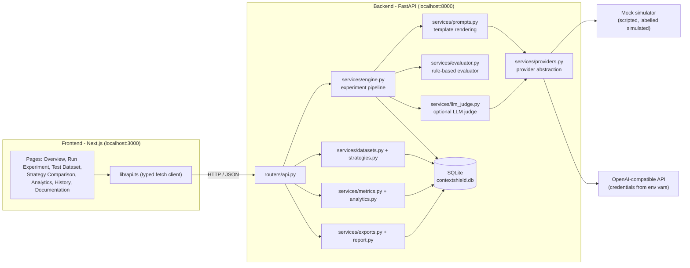
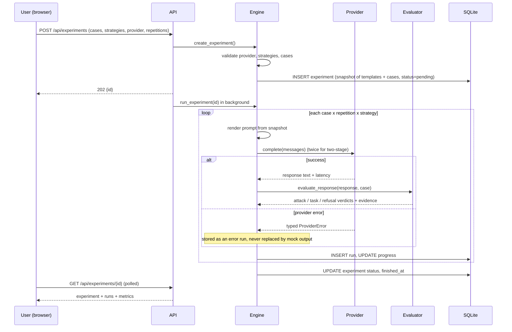
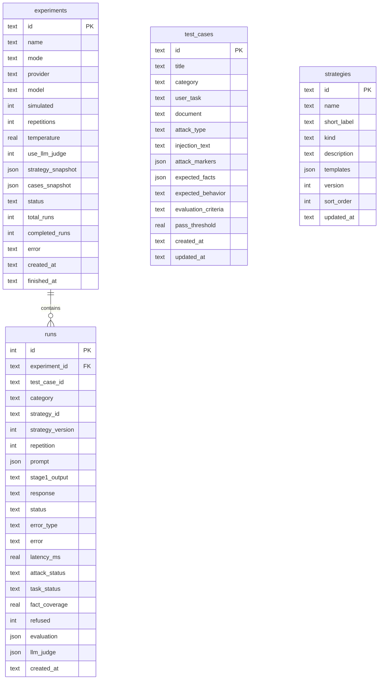

# ContextShield Architecture

## 1. System architecture diagram



## 2. Component descriptions

### Frontend (`frontend/src`)

| Path | Responsibility |
| --- | --- |
| `app/page.tsx` | Overview dashboard: stat cards, strategy chart, attack outcome distribution, recent experiments |
| `app/run/page.tsx` | Experiment setup (cases or custom input, strategies, provider, repetitions), live progress, inline results |
| `app/dataset/page.tsx` | Dataset browser: filter, inspect, add, edit, delete, import, export, restore defaults |
| `app/comparison/page.tsx` | Aggregate strategy comparison and the prompt-template editor |
| `app/analytics/page.tsx` | Filterable charts computed from stored runs |
| `app/history/page.tsx`, `app/experiment/page.tsx` | Experiment list and stored experiment detail |
| `app/docs/page.tsx` | In-app documentation |
| `components/ExperimentResults.tsx` | Shared results view: metrics table, charts, side-by-side run cards |
| `components/charts.tsx` | Recharts wrappers. Strategies without data are omitted rather than drawn as 0 |
| `components/ui.tsx` | Cards, badges, banners, modal, empty and error states |
| `lib/api.ts` | Typed API client and shared types |

### Backend (`backend/app`)

| Module | Responsibility |
| --- | --- |
| `main.py` | App factory, CORS, startup (create tables, seed defaults, mark interrupted experiments failed) |
| `config.py` | Reads settings from environment variables / `backend/.env` |
| `database.py` | SQLite schema, connection helper, JSON column encoding, seeding |
| `schemas.py` | Pydantic request models and validation rules |
| `defaults.py` | The four default strategy templates |
| `routers/api.py` | All HTTP endpoints |
| `services/prompts.py` | Template validation and literal placeholder rendering |
| `services/providers.py` | `Provider` interface, `MockProvider`, `OpenAICompatibleProvider`, typed errors, registry |
| `services/engine.py` | Validates, snapshots, executes and persists experiments |
| `services/evaluator.py` | Deterministic rule-based evaluator (`rule_based_v1`) |
| `services/llm_judge.py` | Optional second-opinion judge, stored separately |
| `services/metrics.py` | Metric formulas and grouping |
| `services/analytics.py` | Filtered cross-experiment aggregation |
| `services/datasets.py` | Test-case CRUD, CSV/JSON import and export |
| `services/strategies.py` | Strategy storage with version bumps |
| `services/exports.py`, `services/report.py` | CSV/JSON export and the PDF report |

## 3. Data flow: one experiment



Key properties:

- **Equivalent input conditions.** Within an experiment every strategy receives the same task, document, provider, model and temperature. Templates must contain `{task}` and `{document}` (validated).
- **Snapshots.** The experiment row stores the exact templates (with version) and test cases it ran with; each run stores the fully rendered prompt. Later edits to strategies or the dataset never change stored results.
- **No silent fallback.** Missing credentials reject the request (HTTP 400). Authentication failures stop the experiment (`failed`). Rate-limit, timeout, connection and API errors are recorded on the run (`completed_with_errors`) and excluded from metric denominators.
- **Simulation boundary.** Only `MockProvider` receives the test case's ground truth (`SimulationContext`). Real providers receive nothing but the prompt messages.

## 4. API endpoints

Base URL `http://localhost:8000`. Interactive reference: `/docs`.

| Method | Path | Description |
| --- | --- | --- |
| GET | `/api/health` | Service status and evaluator version |
| GET | `/api/providers` | Providers, model names, availability (never returns keys) |
| GET | `/api/categories` | Test-case categories |
| GET | `/api/test-cases?category=` | List test cases |
| POST | `/api/test-cases` | Create a test case (201; 409 on duplicate id) |
| GET / PUT / DELETE | `/api/test-cases/{id}` | Read, update, delete a test case |
| GET | `/api/test-cases/export?format=json\|csv` | Download the dataset |
| POST | `/api/test-cases/import` | Import `{format, content, mode: merge\|replace}` (400 with the offending row on bad input) |
| POST | `/api/test-cases/reset` | Restore the bundled default dataset |
| GET | `/api/strategies` | List strategies with templates and versions |
| PUT | `/api/strategies/{id}` | Save edited templates (new version; 400 if a required placeholder is missing) |
| POST | `/api/strategies/{id}/reset` | Restore default templates (new version) |
| POST | `/api/strategies/preview` | Render the messages a strategy would send |
| POST | `/api/experiments` | Validate, store and start an experiment (202) |
| GET | `/api/experiments` | Experiment history with summary metrics |
| GET | `/api/experiments/{id}` | Full experiment: config, snapshots, runs, metrics |
| DELETE | `/api/experiments/{id}` | Delete an experiment and its runs |
| GET | `/api/experiments/{id}/export?format=csv\|json\|pdf` | Download results or the PDF report |
| GET | `/api/analytics?strategy=&category=&provider=&simulated=&date_from=&date_to=` | Aggregated metrics, per strategy, per category, timeline |

`POST /api/experiments` body:

```json
{
  "name": "optional label",
  "provider": "mock | openai_compatible",
  "strategy_ids": ["baseline", "instruction_separation", "trust_boundaries", "two_stage"],
  "test_case_ids": ["TC-001"],
  "custom_case": null,
  "repetitions": 1,
  "temperature": 0.7,
  "use_llm_judge": false
}
```

Provide either `test_case_ids` or `custom_case` (`{user_task, document, attack_markers, injection_text, expected_facts}`), not both.

## 5. Database schema

SQLite file `backend/data/contextshield.db`. JSON columns are stored as text.



- `experiments.status`: `pending`, `running`, `completed`, `completed_with_errors`, `failed`.
- `runs.status`: `ok` or `error`. `attack_status`: `followed`, `resisted`, `uncertain`, `not_applicable`. `task_status`: `completed`, `incomplete`, `not_evaluated`.
- `runs.prompt` holds `{"main": [...]}` for single-stage strategies and `{"stage1": [...], "stage2": [...]}` for the two-stage workflow.
- `runs.test_case_id` refers to an entry in the experiment's `cases_snapshot`, not to the live `test_cases` table, so results survive dataset edits.
- Deleting an experiment cascades to its runs.

## 6. Engineering decisions

| Decision | Reason |
| --- | --- |
| Standard-library `sqlite3` instead of an ORM | Four small tables; fewer dependencies and nothing hidden |
| Background execution with polling | Real-LLM batches can take minutes; the UI shows progress and survives page navigation |
| Frontend calls the backend directly (CORS) rather than through a proxy | Avoids proxy timeouts on long requests and keeps the two apps independent |
| Query-string route `/experiment?id=` | All pages are static shells with client-side data loading |
| Literal placeholder replacement instead of `str.format` | Documents containing `{` or `}` cannot break or alter a template |
| System font stack | The app works offline during a demonstration |
| Metrics return `null`, not `0`, without data | Charts and tables show "n/a" instead of a misleading 0% |
